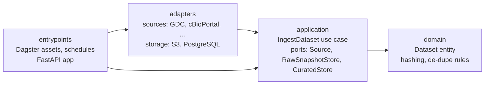

# OrisunIwadi

*Orísun Ìwádìí* is Yoruba for "source of research".

OrisunIwadi is a data platform for public cancer research data. It loads five datasets into a raw
S3 zone and a curated PostgreSQL store. Every run is idempotent: running it again with the same
data changes nothing.

| Dataset | Source | Rows | Primary key |
|---|---|---:|---|
| `gdc_tcga_cases` | NCI Genomic Data Commons (TCGA) | 11,428 | `case_id` |
| `cbioportal_studies` | cBioPortal | 551 | `study_id` |
| `clinical_trials_cancer` | ClinicalTrials.gov (recruiting) | 18,775 | `nct_id` |
| `cdc_cancer_indicators` | CDC Chronic Disease Indicators | 27,432 | 6-column composite |
| `civic_evidence` | CIViC | 11,752 | `evidence_id` |

Row counts are from the run on 3 Nov 2026.

## Architecture

The code follows **clean architecture**: dependencies only point inward, and the core has no
framework or I/O code. `tests/unit/test_architecture.py` fails the build if any import breaks
this rule.



| Layer | Folder | Knows about | Example |
|---|---|---|---|
| Domain | `domain/` | nothing else | `Dataset`, `prepare_rows()`, `raw_object_key()` |
| Application | `application/` | domain | `IngestDataset`, port interfaces |
| Adapters | `adapters/` | application, domain | `S3RawSnapshotStore`, `PostgresCuratedStore`, `sources/gdc.py` |
| Entrypoints | `entrypoints/` | everything | Dagster assets and FastAPI routes wire adapters into use cases |

What this buys:
- The use case is tested with in-memory fakes, with no Docker or network: [tests/unit/test_ingest_dataset.py](tests/unit/test_ingest_dataset.py).
- Swapping Postgres or S3, or adding the FastAPI entrypoint, doesn't touch the core.
- Adding a dataset means adding one file in `adapters/sources/`.

The full system design (data flow, AWS deployment, AWS Well-Architected review) is in
[docs/architecture.md](docs/architecture.md).

### How idempotency works

| Layer | Mechanism | Second identical run |
|---|---|---|
| Raw file | S3 key is the sha256 of the sorted, canonical content | upload skipped |
| Rows | `INSERT … ON CONFLICT DO UPDATE … WHERE _record_hash IS DISTINCT FROM …` | 0 inserted, 0 updated |
| One run | Duplicate keys collapse to one row (last wins) | no key conflicts |
| Bad rows | `quality.quarantine` is keyed by dataset + row hash | 0 new quarantined rows |

## Data quality

Every row is checked before loading: primary key present, each value valid for its column
type, and a few rules per dataset (e.g. CIViC `evidence_rating` is 1–5, NCT IDs match
`NCT\d{8}`). Failing rows go to `quality.quarantine` with the reasons; the rest still load.
Dagster shows two checks per dataset: `quarantine_rate_ok` (warns above 5%) and
`table_not_empty`.

```sql
SELECT dataset, reasons, row_data FROM quality.quarantine ORDER BY quarantined_at DESC;
```

## Provenance

Every run of every dataset is logged in `catalog.runs`: status, timings, the git commit of the
code, the raw file's sha256 and S3 location, and row counts. Failed runs are logged with their
error. `catalog.datasets` holds each dataset's source, columns, key and rules.

Each curated row has a `_run_id`, so any row can be traced to the run, raw file and code
version that produced it:

```sql
SELECT r.started_at, r.code_version, r.raw_s3_uri
FROM oncology.civic_evidence e JOIN catalog.runs r
  ON r.run_id = e._run_id AND r.dataset = 'civic_evidence'
WHERE e.evidence_id = 1;
```

## Run it locally

You need [uv](https://docs.astral.sh/uv/), Docker (Colima works), and docker-compose.

```bash
cp .env.example .env
make setup     # install Python deps into .venv
make up        # start Postgres (port 5433) + SeaweedFS S3 (port 8333)
make test      # unit + integration tests
make dev       # Dagster UI at http://localhost:3000, then materialize "ingest_all"
make psql      # SQL shell, e.g.  SELECT count(*) FROM oncology.gdc_tcga_cases;
make user NAME=alice ROLE=researcher   # create an API user (asks for a password)
make api       # API at http://localhost:8000, interactive docs at /docs
```

For a quick run, set `max_records: 200` in the Dagster launchpad config.

## Fault tolerance

A failure in one part stays in that part:
- One broken source fails only its own dataset; the rest load.
- A run that looks wrong (too many bad rows, most rows changing, empty source) is rolled back
  by a safety brake, so good data is never overwritten by a bug.
- If the database goes down, the API answers 503 quickly instead of hanging, and recovers by
  itself when the database is back.
- The pipeline and the API use separate database users with their own permissions,
  connection limits and timeouts.

Details and the test for each failure: [docs/architecture.md](docs/architecture.md#fault-tolerance).

## API

Read-only, role-based access to the curated data. Log in for a 30-minute token:

```bash
TOKEN=$(curl -s -X POST localhost:8000/auth/token -d "username=alice&password=..." | jq -r .access_token)
curl -H "Authorization: Bearer $TOKEN" "localhost:8000/datasets/gdc_tcga_cases/rows?primary_site=Breast&limit=10"
```

| Role | Can use |
|---|---|
| `viewer` | `/datasets`, `/datasets/{name}`, `/datasets/{name}/counts?by=column` |
| `researcher` | + `/datasets/{name}/rows` (row-level data; `?column=value` filters) and full exports |
| `admin` | + `/admin/quarantine`, `/admin/runs` |

### Exporting data

```bash
# Whole table, or only the rows you filter for. Opens in Excel, R, pandas.
curl -H "Authorization: Bearer $TOKEN" -OJ "localhost:8000/datasets/gdc_tcga_cases/export.csv?primary_site=Breast"
# Same data as Parquet: typed columns, ~10x smaller, provenance in the file metadata.
curl -H "Authorization: Bearer $TOKEN" -OJ "localhost:8000/datasets/gdc_tcga_cases/export.parquet"
# Viewers can download grouped counts (small groups hidden).
curl -H "Authorization: Bearer $TOKEN" -OJ "localhost:8000/datasets/gdc_tcga_cases/counts.csv?by=primary_site"
```

```python
import pandas as pd
df = pd.read_parquet("gdc_tcga_cases_20261105.parquet")
```

Exports include the lineage columns (`_run_id`, `_raw_s3_uri`, …), are capped at 200,000
rows (add filters for more), and never arrive as a silently broken file: Parquet is built
fully before sending (any failure is a 503), and a CSV that fails mid-download is cut off so
the client reports it as incomplete.

Grouped counts hide groups with fewer than 10 rows (small-cell suppression). The API's
database sessions are read-only. Full list and try-it-out at http://localhost:8000/docs.

## AWS

The same image runs on AWS: the API on ECS Fargate (2+ copies in two Availability Zones,
behind a load balancer and WAF), the daily load as a scheduled task that exits when done, and
PostgreSQL on RDS in subnets with no internet route. Every part has its own minimal IAM role;
the API has none at all. Details, cost and deploy steps: [docs/aws.md](docs/aws.md).

```bash
make tf-check          # validate + offline tests of the Terraform (AWS mocked, no account)
make image             # build the container image locally
make aws-push aws-apply aws-db-roles   # deploy (needs an AWS account; costs money)
```

## Project layout

```
src/orisun_iwadi/
├── domain/            dataset.py, records.py, quality.py, access.py   pure rules, no I/O
├── application/       ports.py, ingest_dataset.py, provenance.py, queries.py, auth.py
├── adapters/
│   ├── sources/       gdc, cbioportal, clinicaltrials, cdc, civic, http
│   ├── security/      passwords.py (scrypt), tokens.py (JWT)
│   └── storage/       S3 raw store, curated/quarantine/catalog/user/read stores, locks
└── entrypoints/
    ├── dagster/       assets.py, resources.py, definitions.py, run_job.py (no-UI runner)
    └── api/           app.py (FastAPI), users.py (user admin CLI)
infra/
├── bootstrap/         Terraform state bucket + image registry (applied once)
├── aws/               VPC, RDS, S3, ECS, IAM, WAF, alarms; tests/ runs offline
└── scripts/           run one-off tasks and add API users on AWS
tests/
├── unit/              no services needed
└── integration/       needs `make up`
Dockerfile             one image for the API, the pipeline and admin tasks
```

## Roadmap

1. ~~Local setup~~ ✅
2. ~~Idempotent ETL for 5 datasets~~ ✅
3. ~~Data-quality checks and a quarantine table~~ ✅
4. ~~Metadata catalog for provenance~~ ✅
5. ~~Role-based FastAPI API~~ ✅
6. ~~AWS with Terraform and least-privilege IAM~~ ✅ ([docs/aws.md](docs/aws.md))
7. CI/CD with GitHub Actions
