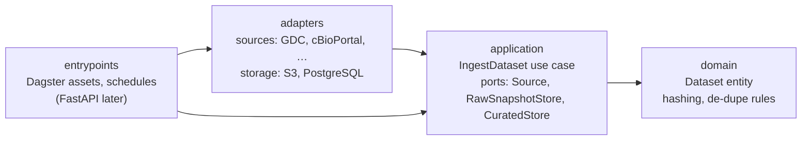

# OrisunIwadi

*Orísun Ìwádìí* is Yoruba for "source of research".

OrisunIwadi is a data platform for public cancer research data. It loads five datasets into a raw
S3 zone and a curated PostgreSQL store. Every run is idempotent: running it again with the same
data changes nothing.

| Dataset | Source | Rows | Primary key |
|---|---|---:|---|
| `gdc_tcga_cases` | NCI Genomic Data Commons (TCGA) | 11,428 | `case_id` |
| `cbioportal_studies` | cBioPortal | 551 | `study_id` |
| `clinical_trials_cancer` | ClinicalTrials.gov (recruiting) | 18,775 | `nct_id` |
| `cdc_cancer_indicators` | CDC Chronic Disease Indicators | 27,432 | 6-column composite |
| `civic_evidence` | CIViC | 11,752 | `evidence_id` |

Row counts are from the run on 3 Nov 2026.

## Architecture

The code follows **clean architecture**: dependencies only point inward, and the core has no
framework or I/O code. `tests/unit/test_architecture.py` fails the build if any import breaks
this rule.



| Layer | Folder | Knows about | Example |
|---|---|---|---|
| Domain | `domain/` | nothing else | `Dataset`, `prepare_rows()`, `raw_object_key()` |
| Application | `application/` | domain | `IngestDataset`, port interfaces |
| Adapters | `adapters/` | application, domain | `S3RawSnapshotStore`, `PostgresCuratedStore`, `sources/gdc.py` |
| Entrypoints | `entrypoints/` | everything | Dagster assets wire adapters into the use case |

What this buys:
- The use case is tested with in-memory fakes, with no Docker or network: [tests/unit/test_ingest_dataset.py](tests/unit/test_ingest_dataset.py).
- Swapping Postgres or S3, or adding the FastAPI entrypoint, doesn't touch the core.
- Adding a dataset means adding one file in `adapters/sources/`.

The full system design (data flow, AWS deployment, AWS Well-Architected review) is in
[docs/architecture.md](docs/architecture.md).

### How idempotency works

| Layer | Mechanism | Second identical run |
|---|---|---|
| Raw file | S3 key is the sha256 of the sorted, canonical content | upload skipped |
| Rows | `INSERT … ON CONFLICT DO UPDATE … WHERE _record_hash IS DISTINCT FROM …` | 0 inserted, 0 updated |
| One run | Duplicate keys collapse to one row (last wins) | no key conflicts |
| Bad rows | `quality.quarantine` is keyed by dataset + row hash | 0 new quarantined rows |

## Data quality

Every row is checked before loading: primary key present, each value valid for its column
type, and a few rules per dataset (e.g. CIViC `evidence_rating` is 1–5, NCT IDs match
`NCT\d{8}`). Failing rows go to `quality.quarantine` with the reasons; the rest still load.
Dagster shows two checks per dataset: `quarantine_rate_ok` (warns above 5%) and
`table_not_empty`.

```sql
SELECT dataset, reasons, row_data FROM quality.quarantine ORDER BY quarantined_at DESC;
```

## Run it locally

You need [uv](https://docs.astral.sh/uv/), Docker (Colima works), and docker-compose.

```bash
cp .env.example .env
make setup     # install Python deps into .venv
make up        # start Postgres (port 5433) + SeaweedFS S3 (port 8333)
make test      # unit + integration tests
make dev       # Dagster UI at http://localhost:3000, then materialize "ingest_all"
make psql      # SQL shell, e.g.  SELECT count(*) FROM oncology.gdc_tcga_cases;
```

For a quick run, set `max_records: 200` in the Dagster launchpad config.

## Project layout

```
src/orisun_iwadi/
├── domain/            dataset.py, records.py, quality.py   pure rules, no I/O
├── application/       ports.py, ingest_dataset.py    use cases + interfaces
├── adapters/
│   ├── sources/       gdc, cbioportal, clinicaltrials, cdc, civic, http
│   └── storage/       s3_raw_store.py, postgres_store.py, quarantine_store.py
└── entrypoints/
    └── dagster/       assets.py, resources.py, definitions.py
tests/
├── unit/              no services needed
└── integration/       needs `make up`
```

## Roadmap

1. ~~Local setup~~ ✅
2. ~~Idempotent ETL for 5 datasets~~ ✅
3. ~~Data-quality checks and a quarantine table~~ ✅
4. Metadata catalog for provenance
5. Role-based FastAPI API (`entrypoints/api/`)
6. AWS with Terraform and least-privilege IAM
7. CI/CD with GitHub Actions
