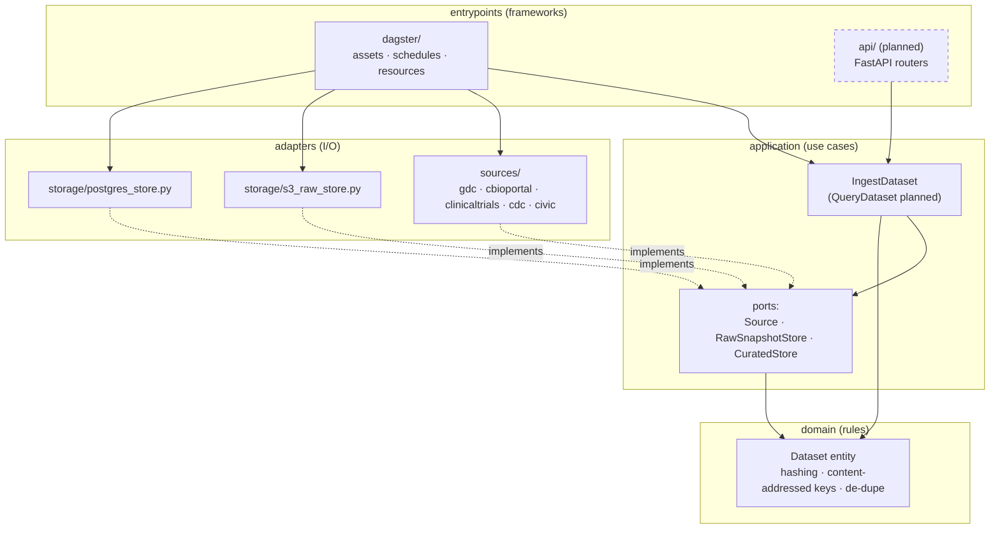
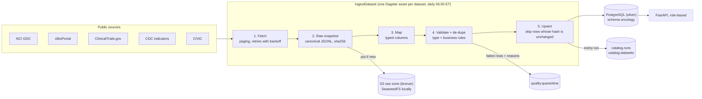
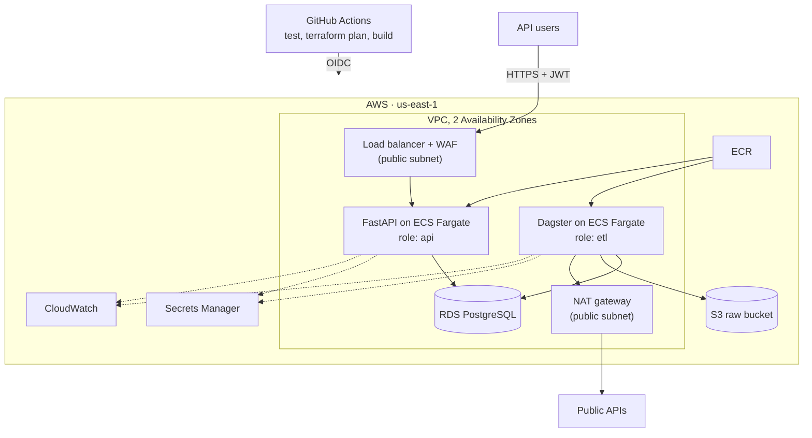

# OrisunIwadi architecture

Solid boxes are built. Dashed boxes are planned.

## 1. Code structure: clean architecture

Imports only point inward. `domain` and `application` contain no framework or I/O code;
`tests/unit/test_architecture.py` enforces both rules.

The FastAPI app will follow the same rule. Routers live in `entrypoints/api/`, use cases in
`application/`, and the read-only repository in `adapters/storage/`.

## 2. Data flow

Every curated row stores `_record_hash`, `_raw_s3_uri` (the raw file it came from),
`_run_id` (the run that last inserted or changed it), `_first_seen_at` and `_last_updated_at`.

### Metadata catalog (provenance)

| Table | One row per | Holds |
|---|---|---|
| `catalog.datasets` | dataset | description, source URL, columns, primary key, quality rules |
| `catalog.runs` | run × dataset | status, start/end time, code version (git commit), source URL, raw file sha256 + S3 URI, row counts, error if it failed |

Failed runs are logged too, with the error. A Dagster retry of the same run replaces its row.
Code version is `GIT_SHA` on AWS (set by CI) or the local commit, with `-dirty` when there
are uncommitted changes.

Tracing a row back to its source: row `_run_id` → `catalog.runs` → `raw_s3_uri` (the exact
raw file) and `code_version` (the exact code that loaded it).

### Concurrency

| Risk | Guard |
|---|---|
| Two runs load the same dataset at once (e.g. schedule + manual) and an older fetch overwrites newer data | Per-dataset Postgres advisory lock, held from fetch to commit. A second run gets `DatasetAlreadyRunning`; Dagster retries it after 30 s. Postgres frees the lock if the process dies. |
| Two runs create the same table at once on a fresh database | Table setup runs under one app-wide advisory lock |
| Table setup blocking readers during a load (`ALTER TABLE` and `CREATE INDEX` lock even when there is nothing to do) | DDL runs only when a table or column is actually missing, and commits right away |
| A step fails half-way | Each store writes in one transaction; a retry re-runs safely because every write is idempotent |

### Data quality

Each row is checked before it is loaded. Rows that fail go to `quality.quarantine` with the
reasons, and the rest of the batch still loads.

| Rule kind | Where defined | Example |
|---|---|---|
| Primary key present | automatic | `case_id is required` |
| Column type | automatic, from each column's Postgres type | `evidence_id='abc' is not a valid integer` |
| Business rule | `rules=` on each dataset in `adapters/sources/` | `evidence_rating=7 outside [1, 5]` |

Quarantined rows are keyed by `(dataset, record_hash)`, so a bad row seen again is not added
twice. Each asset has two Dagster asset checks: `quarantine_rate_ok` (warns above 5%) and
`table_not_empty` (error).

## 3. AWS deployment (planned)

Least privilege: the ETL role can write only to `raw/*` in the raw bucket and read its own
database secret. The API role has no S3 access and connects as a read-only database user.

## 4. Build status

| Phase | Scope | Status |
|---|---|---|
| 1. Local setup | uv, Docker Compose (Postgres + SeaweedFS), Dagster | Done |
| 2. ETL | 5 datasets → S3 + Postgres, idempotent, clean architecture | Done |
| 3. Data quality | Validation, quarantine table, Dagster asset checks | Done |
| 4. Metadata catalog | Provenance for every run, row-level lineage | Done |
| 5. API | FastAPI + JWT roles | Next |
| 6. AWS | Terraform: VPC, S3, RDS, ECS, IAM | Planned |
| 7. CI/CD | GitHub Actions | Planned |
