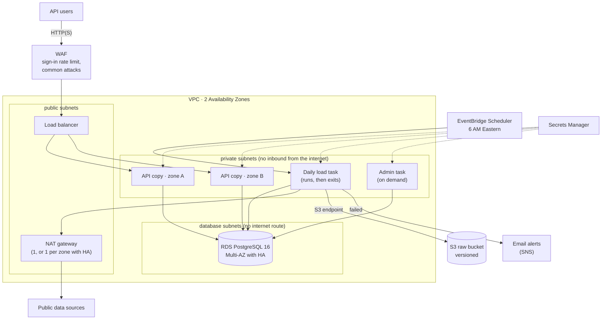

# Running OncoLake on AWS

Everything is defined in Terraform (`infra/`). Nothing is created until you run the commands
below, and `make aws-destroy` removes it again.

## What gets created



| Part | AWS service | Notes |
|---|---|---|
| API | ECS Fargate service, 2-4 copies | Behind a load balancer and WAF; scales on CPU |
| Daily load | ECS Fargate task, started by EventBridge Scheduler | Runs `run_job ingest_all`, then exits: no idle server |
| Database | RDS PostgreSQL 16 | Private, encrypted, TLS required, point-in-time backups (7 days by default; 1 on the free plan) |
| Raw files | S3 | Versioned, encrypted, TLS only, older files move to cheaper storage after 90 days |
| Secrets | Secrets Manager | Generated by Terraform but never stored in its state |
| Image | ECR | One image for all tasks, tagged with the git commit, scanned on push |
| Alerts | CloudWatch alarms + SNS email | API down, many errors, failed load, database storage/CPU, budget |

## Least privilege

| Who | Can do |
|---|---|
| API tasks | **No AWS permissions at all.** Read-only database user. Reachable only from the load balancer. |
| Pipeline tasks | Read/write `raw/*` in the raw bucket. Own database user. No inbound network access. |
| Admin task | Read API-user passwords under `oncolake/users/*`. Database admin (for `db-roles.sql` and users). |
| Scheduler | Start the pipeline task in this cluster, nothing else. |
| Each task's start-up role | Pull the image, write its own logs, read **its own** secrets only. |
| Database | Accepts connections only from the API, pipeline and admin tasks. |

## Fault tolerance on AWS

| Failure | What happens |
|---|---|
| An API copy crashes or hangs | The load balancer stops sending it traffic; ECS starts a replacement. The other copy keeps serving. |
| A whole Availability Zone goes down | The API copy in the other zone keeps serving. With `high_availability = true` the database fails over to its standby (1-2 min) and the other zone has its own NAT gateway. |
| Database down | API answers 503 quickly and recovers by itself. Health checks use `/health`, so ECS doesn't restart every copy over a problem a restart can't fix. |
| A bad deploy | New copies must pass health checks before old ones stop. If they don't, ECS rolls back automatically and `make aws-apply` fails. |
| A dataset fails to load | The other datasets still load. The task exits with an error and you get an email. |
| The scheduler can't start the task | It retries for up to an hour. |
| Password guessing or one client flooding the API | WAF blocks the IP address for a while (20 sign-ins or 3,000 requests per 5 minutes). |
| Accidental delete | Database and load balancer have deletion protection; S3 keeps old versions; RDS keeps backups. |

## Cost

Rough monthly cost in us-east-1, running all month:

| | Default | `high_availability = true` |
|---|---|---|
| NAT gateway(s) + public IPs | ~$45 | ~$80 |
| Load balancer | ~$18 | ~$18 |
| API (2 small Fargate copies) | ~$15 | ~$15 |
| Database (db.t4g.micro) | ~$15 | ~$30 |
| WAF | ~$10 | ~$10 |
| Daily load, secrets, logs, alarms | ~$5 | ~$5 |
| **Total** | **~$110** | **~$160** |

A budget alert emails you at 80% of `monthly_budget_usd` (default $120). To keep costs down,
deploy for a demo and run `make aws-destroy` afterwards; everything can be recreated with the
same commands.

## Deploying

You need an AWS account of your own, the AWS CLI (2.32+), Terraform 1.11+ and Docker.

**Use a separate account for OncoLake.** A new account on the AWS free plan gets $100-200 in
credits and is never charged. The deploy commands only work against the account you name, so
they can't touch any other account you are signed in to.

```bash
# Once: sign in to the OncoLake account under its own profile (opens your browser;
# short-lived credentials, no access keys saved on disk)
aws login --profile oncolake
# then in .env:  ONCOLAKE_AWS_ACCOUNT_ID=<the 12-digit account number>
make aws-check                # confirms the profile is that account, refuses anything else

make aws-bootstrap            # state bucket + image registry
make aws-init                 # connect infra/aws to the state bucket
cp infra/aws/terraform.tfvars.example infra/aws/terraform.tfvars   # set alert_email

# Every release (commit first: the image is tagged with the commit)
make aws-push                 # build and push the image
make aws-apply                # create/update everything, deploy the API (waits until healthy)

# After the first apply
make aws-db-roles             # create the database users
make aws-user NAME=you ROLE=admin
make aws-load                 # load the data now instead of waiting for 6 AM
```

`make aws-apply` prints `api_url`. Open it for the landing page, `/docs` for the API.

Check the infrastructure without an AWS account: `make tf-check` (format, validate, and offline
tests with AWS mocked) and `uvx checkov --config-file .checkov.yaml -d infra` (security scan;
skipped checks are listed with reasons in `.checkov.yaml`).

### Rotating secrets

Increase `secrets_version` in `terraform.tfvars`, then `make aws-apply` and `make aws-db-roles`.
The RDS admin password is rotated by RDS itself.

### Tearing down

Set `deletion_protection = false`, run `make aws-apply`, then `make aws-destroy`. The state
bucket and image registry (from `aws-bootstrap`) are kept. API-user secrets created by
`make aws-user` are not managed by Terraform; delete them in Secrets Manager if you're done.

## Known limits

- No HTTPS without a domain: set `certificate_arn` (an ACM certificate) before real use.
  Until then, narrow `allowed_cidrs` to your own IP address.
- The Dagster UI isn't deployed; runs are recorded in `catalog.runs` (`/admin/runs`) and the
  pipeline logs are in CloudWatch (`/ecs/oncolake/etl`). Use `make dev` locally for the UI.
- The daily CSV/Parquet download files are written to `s3://<raw bucket>/exports/` and kept 30
  days. Without the Dagster UI there's no page with their links; download them from the S3
  console, or through the API's export endpoints. (Links signed by a task's temporary
  credentials stop working within hours, so on AWS they are only useful right after a run.)
- The bootstrap stack keeps its Terraform state on your machine (`infra/bootstrap`). If it is
  lost, the two resources can be re-imported.
